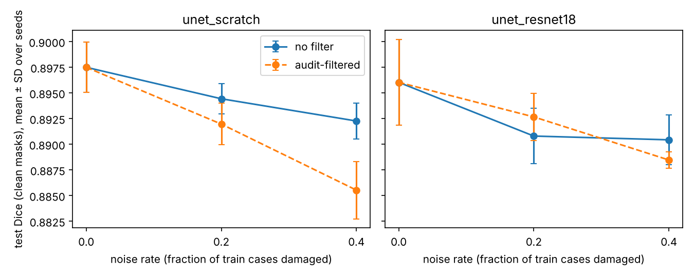

# Label noise -> training -> audit filter -> INT8 quantization (minimal closed loop, 2D slices)

Owner: Feixiang Xiao. Method demo on a small public dataset; no clinical claim.

## Question
When training masks are damaged in known ways, how much does a small 2D segmentation model lose, how much of that does an existing audit check win back by filtering, and what does post-training INT8 quantization cost in Dice versus CPU speed?

## Data
MSD Task04 Hippocampus (CC-BY-SA 4.0), binary mask, 260 cases (about 35x50x35 voxels), 2D axial slices that contain mask voxels, padded to 64x64. Split by case (never by slice): train 0-159, val 160-199, test 200-259; val/test masks are always clean. All masks go through the same Gaussian smoothing (`audit.damage.clean_mask`) so damaged masks cannot be recognised by blockiness.

## What was done
1. Noise: rate r in {0, 0.2, 0.4} of train cases get a damaged 3D mask (wrong size, shift or extra island, uniformly drawn, target Dice 0.8; achieved 0.797-0.804). One noise realisation (seed 0), nested across rates. `results/noise_manifest.csv`.
2. Models: A = small U-Net from scratch (4 levels, base 16); B = U-Net with ImageNet ResNet18 encoder (conv1 averaged to 1 channel). BCE+Dice, Adam 1e-3, flip augmentation, early stopping on clean val Dice, 3 seeds. 30 runs logged in MLflow (`mlflow.db`, local SQLite).
3. Audit filter: `Calibrated.combined` (fitted on clean val masks only) scores every train case; the top round(rate x 160) are dropped (k = nominal rate, manifest not used); both models are retrained on the rest.
4. INT8: rate-0 seed-0 models -> ONNX (opset 17) -> ONNX Runtime static INT8 (QDQ, 100 train calibration slices); FP32 vs INT8 on clean test slices.
Dice = mean over cases of the Dice pooled over that case's slices, using slices that contain clean mask voxels.

## Results (all from `results/*.csv`; full tables and numbers in `RESULTS_FOR_CV.md`)
- Noise cost is small: test Dice 0.8975 -> 0.8923 (scratch) and 0.8960 -> 0.8904 (ResNet18) from rate 0 to 0.4, mean over 3 seeds, i.e. about 0.5 Dice points.
- Audit filter: caught 24/32 (rate 0.2) and 53/64 (0.4) damaged cases; recall by kind at 0.4: size 0.89, shift 0.61, island 1.00. Retraining on the filtered set did NOT recover Dice (rate 0.4: scratch 0.8855 vs 0.8923 unfiltered, ResNet18 0.8885 vs 0.8904).
- INT8 (4-core cloud CPU, 1 thread, batch 1): scratch FP32 -> INT8 Dice 0.8952 -> 0.8952, 1.93 -> 0.53 MB, median 2.58 -> 1.18 ms; ResNet18 Dice 0.8912 -> 0.8779, 57.3 -> 14.5 MB, median 6.07 -> 2.10 ms.



## Step 5b: synthetic data arm (optional)
Does domain-randomised synthetic data help a small real-data model? 500 synthetic ellipsoid volumes (random pose, size, contrast, blur, noise), Model A, 3 seeds, tested on clean real cases 200-259.
- (i) 20 real cases only: 0.8568 ± 0.0062; (ii) synthetic pretraining then fine-tune on the same 20 cases: 0.8673 ± 0.0059; (iii) synthetic only, no real case: 0.3429 ± 0.0094.
- (ii) beat (i) by 0.0105 on average (more than 1 SD), but not in every seed (+0.0145, +0.0173, -0.0003) and the validation gap was only 0.0028, so this is a weak positive. (iii) shows a large sim-to-real gap: the toy ellipsoids are not a hippocampus (contrast-to-noise 2.41 vs 0.55 for real data; histogram distance 0.066).
- P6 held; P7 met by the ">1 SD" rule on the mean but weakly. One generator configuration, not tuned on test. Toy generator, not realistic image simulation.

## Predictions (DESIGN.md) vs outcome
- P1 (rate 0.4 lower than rate 0, by more than 1 SD): held for both models, ResNet18 only marginally (drop 0.0056 vs SD 0.0042 at rate 0).
- P2 (pretrained encoder loses less from noise): not supported (0.0056 vs 0.0052 loss).
- P3 (filtering recovers part of the loss; recall < 0.8): not supported. Filtering did not recover Dice, and recall at rate 0.4 was 0.83 (shift recall was low, 0.53-0.61, as expected).
- P4 (INT8 loses < 0.01 Dice): held for scratch (0.0000), failed for ResNet18 (-0.0133).
- P5 (INT8 3-4x smaller; latency unclear, I expected no gain for scratch): size 3.7x / 4.0x; latency was lower for both (2.2x / 2.9x), so the direction I expected for scratch was wrong.

## What it means
At this noise size (Dice 0.8 on 20-40% of train cases) and this dataset, the small 2D models barely care about label noise, so there is little to "recover"; the audit filter finds most damaged cases (all islands, most size errors, few shifts) but removing 20-40% of the training cases costs more than it gains. INT8 is cheap for the small U-Net and costs 0.013 Dice for the ResNet18 model.

## Limits
- One small public dataset (MSD Task04 Hippocampus, CC-BY-SA 4.0), 2D slices about 50x35 px, method demo only, no clinical claim.
- Damage is synthetic; its size (Dice 0.8) is not matched to real annotator disagreement.
- 3 training seeds, one split, one noise realisation; SD is across seeds only.
- Dice only uses slices that contain mask voxels (empty slices are not scored).
- INT8 numbers come from one model per architecture (rate 0, seed 0) and a single latency measurement.
- Post-training INT8 on a 4-core cloud CPU (ONNX Runtime 1.29.0, 1 thread), not an embedded target, no QAT; latency is not a laptop or device number.
- Pretrained encoder is an ImageNet ResNet18, not a vision foundation model.
- During the run the cloud container restarted several times; training resumed from per-epoch checkpoints (same RNG stream). The interrupted logs are in `results/main_log_interrupted_*.txt`.

## Files
`DESIGN.md` (design, predictions, deviation log), `config.py`, `src/` (data, noise, models, train, run_main, quant, report), `audit/` (existing audit code, unchanged), `watchdog.sh`, `run_all.py`, `src/synth_dr.py`, `src/run_5b.py`, `watchdog_5b.sh`, `results/` (runs_5b.csv, summary_5b.csv, synth_params.csv, synth_realism.csv, runs.csv, noise_manifest.csv, filter_stats.csv, main_table.csv, quant.csv, dice_vs_noise.png, logs), `RESULTS_FOR_CV.md`.

## Reproduce
```
pip install torch torchvision onnx onnxruntime mlflow nibabel scipy pandas matplotlib
python -m src.run_5b       # optional Step 5b (synthetic arm), resumable
python run_all.py          # noise manifest + 30 runs + filter stats + quantization + table/figure; resumable
```
